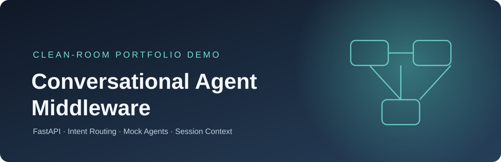
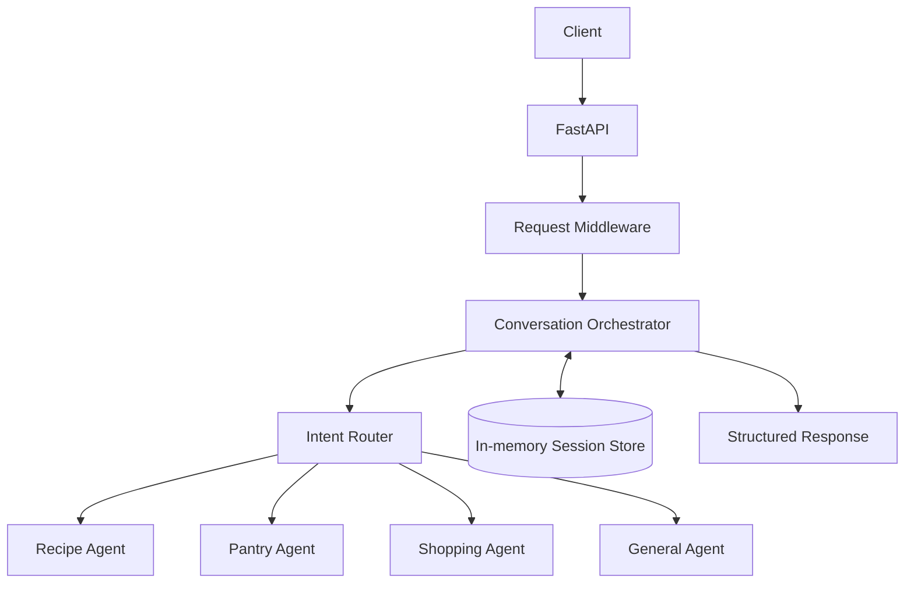

<p align="center"></p>

# Conversational Agent Middleware Demo

A clean-room, synthetic portfolio project demonstrating middleware for a multi-capability conversational assistant. It provides a FastAPI interface, request validation, lightweight intent routing, mock specialist agents, and in-memory conversation context.

**This is an independently written demonstration.** No original source files, prompts, datasets, credentials, infrastructure configuration, or client documentation are included.

## Capabilities

- Chat API with request IDs and structured responses.
- Rule-based intent router for recipe, pantry, shopping, and general questions.
- Mock specialist handlers with synthetic example data.
- In-memory conversation history with bounded context.
- Health and capability endpoints.
- Unit tests for routing, middleware orchestration, and API behavior.

## Architecture



## Project layout

```text
.
├── app/
│   ├── api/routes.py
│   ├── middleware/request_context.py
│   ├── models/schemas.py
│   ├── services/
│   │   ├── agents.py
│   │   ├── orchestrator.py
│   │   ├── router.py
│   │   └── session_store.py
│   └── main.py
├── tests/
├── assets/project-banner.svg
├── requirements.txt
└── .env.example
```

## Run locally

```bash
python -m venv .venv
# Windows: .venv\Scripts\activate
# macOS/Linux: source .venv/bin/activate
pip install -r requirements.txt
uvicorn app.main:app --reload
```

API documentation: `http://127.0.0.1:8000/docs`

## Example

```bash
curl -X POST http://127.0.0.1:8000/chat \
  -H "Content-Type: application/json" \
  -d '{"session_id":"demo-session","message":"Suggest a quick dinner"}'
```

## Tests

```bash
pytest -q
```

## Design notes

- Agent responses are deterministic mock responses; no external LLM is called.
- Session state is held in process memory and is cleared when the application restarts.
- Request middleware adds a correlation ID to each response.
- The router is intentionally transparent and replaceable.

## Security and scope

All example identities, messages, recipes, and pantry items are synthetic. The demo has no authentication provider, external database, cloud account, telemetry endpoint, deployment target, or API secret. Add such integrations only through independently designed code and credentials you are authorized to use.

This repository is a learning/portfolio scaffold, not a production-ready agent platform.
